

<picture>
  <source media="(prefers-color-scheme: dark)" srcset="assets/hero-dark.svg">
  
</picture>

<picture>
  <source media="(prefers-color-scheme: dark)" srcset="https://readme-typing-svg.demolab.com/?font=JetBrains+Mono&weight=500&size=15&duration=3200&pause=1000&center=true&vCenter=true&width=640&height=32&background=00000000&color=2DD4BF&lines=Autonomous+coding+agents+evaluated+on+SWE-bench;Agentic+RAG+%C2%B7+LLM+systems+%C2%B7+applied+deep+learning;From+research+prototype+to+deployed+system">
  
</picture>

<picture>
  <source media="(prefers-color-scheme: dark)" srcset="assets/h-about-dark.svg">
  
</picture>

- Computer Science student currently working on projects in **Machine Learning and Artificial Intelligence**
- Exploring **agentic systems** and **applied ML**
- Genuinely curious about how things work under the hood — not just using a model or framework, but understanding *why* it behaves the way it does
- Comfortable moving between exploring research ideas and shipping practical solutions
- Enjoy building things end-to-end, from concept to working system
- Sharpening fundamentals in **data structures & algorithms**
- Exploring the latest developments in AI and staying up to date

<picture>
  <source media="(prefers-color-scheme: dark)" srcset="assets/h-projects-dark.svg">
  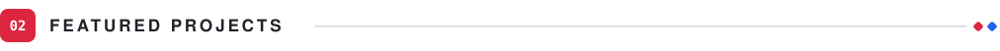
</picture>

<a href="https://github.com/aryanranade/autonomous-issue-resolver"><picture>
  <source media="(prefers-color-scheme: dark)" srcset="assets/p-autonomous-issue-resolver-dark.svg">
  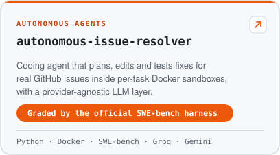
</picture></a>
<a href="https://github.com/aryanranade/ledgerloop"><picture>
  <source media="(prefers-color-scheme: dark)" srcset="assets/p-ledgerloop-dark.svg">
  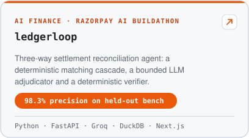
</picture></a>
<a href="https://github.com/aryanranade/TBSentinel"><picture>
  <source media="(prefers-color-scheme: dark)" srcset="assets/p-TBSentinel-dark.svg">
  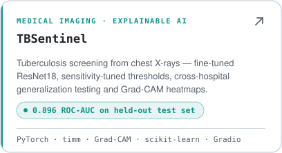
</picture></a>
<a href="https://github.com/aryanranade/Development-of-AI-Based-Knowledge-Retrieval-Platform-with-Query-Resolution-System"><picture>
  <source media="(prefers-color-scheme: dark)" srcset="assets/p-knowledge-retrieval-platform-dark.svg">
  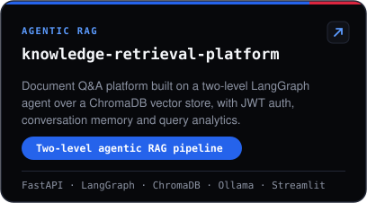
</picture></a>
<a href="https://github.com/aryanranade/finance-tracker"><picture>
  <source media="(prefers-color-scheme: dark)" srcset="assets/p-finance-tracker-dark.svg">
  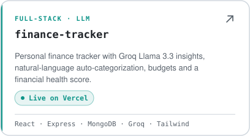
</picture></a>
<a href="https://github.com/aryanranade/horizon-dashboard"><picture>
  <source media="(prefers-color-scheme: dark)" srcset="assets/p-horizon-dashboard-dark.svg">
  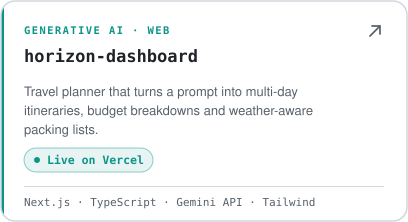
</picture></a>

<picture>
  <source media="(prefers-color-scheme: dark)" srcset="assets/h-more-dark.svg">
  
</picture>

| Project | Summary | Built with |
|:--|:--|:--|
| [**notes-api**](https://github.com/aryanranade/notes-api) [Live demo ↗](https://notes-api-4d3i.onrender.com/api-docs) | Secure REST API for notes — JWT role-based access control, Zod validation, pagination & search, OpenAPI docs | TypeScript · Express · Prisma · PostgreSQL |
| [**weather-dashboard**](https://github.com/aryanranade/weather-dashboard) [Live demo ↗](https://weather-dashboard-omega-mocha.vercel.app) | Full-stack weather app with stateless JWT auth via Spring Security and saved cities | Java · Spring Boot · React |
| [**Kanban-Board**](https://github.com/aryanranade/Kanban-Board) [Live demo ↗](https://kanban-board-five-eosin.vercel.app) | Responsive task board with custom workflow stages, built without UI libraries | React · Vite |
| [**SyncMind**](https://github.com/TejasSharma356/SyncMind) [Live demo ↗](https://sync-mind.vercel.app) | *Team project, contributor* — AI meeting assistant that turns calls into transcripts, summaries and action items | React · Vite · AWS |

<picture>
  <source media="(prefers-color-scheme: dark)" srcset="assets/h-stack-dark.svg">
  
</picture>

<table>
  <tr>
    <td><b>Languages</b></td>
    <td>
      
      
      
      
      
    </td>
  </tr>
  <tr>
    <td><b>ML &amp; Data</b></td>
    <td>
      
      
      
      
      
      
      
      
    </td>
  </tr>
  <tr>
    <td><b>LLMs &amp; Agents</b></td>
    <td>
      
      
      
      
      
      
      
    </td>
  </tr>
  <tr>
    <td><b>Backend &amp; APIs</b></td>
    <td>
      
      
      
      
      
      
      
      
      
      
    </td>
  </tr>
  <tr>
    <td><b>Databases</b></td>
    <td>
      
      
      
      
    </td>
  </tr>
  <tr>
    <td><b>Frontend &amp; UI</b></td>
    <td>
      
      
      
      
      
      
      
    </td>
  </tr>
  <tr>
    <td><b>DevOps &amp; Testing</b></td>
    <td>
      
      
      
      
      
      
      
      
      
    </td>
  </tr>
</table>

<picture>
  <source media="(prefers-color-scheme: dark)" srcset="assets/h-analytics-dark.svg">
  
</picture>

<picture>
  <source media="(prefers-color-scheme: dark)" srcset="assets/stats-dark.svg">
  
</picture>
<picture>
  <source media="(prefers-color-scheme: dark)" srcset="assets/langs-dark.svg">
  
</picture>

<picture>
  <source media="(prefers-color-scheme: dark)" srcset="assets/activity-dark.svg">
  
</picture>

<picture>
  <source media="(prefers-color-scheme: dark)" srcset="https://raw.githubusercontent.com/aryanranade/aryanranade/output/snake-dark.svg">
  
</picture>

<picture>
  <source media="(prefers-color-scheme: dark)" srcset="assets/h-connect-dark.svg">
  
</picture>

<a href="mailto:aryan.a.ranade@gmail.com"><picture>
  <source media="(prefers-color-scheme: dark)" srcset="assets/c-email-dark.svg">
  
</picture></a>
<a href="https://www.linkedin.com/in/aryanranade"><picture>
  <source media="(prefers-color-scheme: dark)" srcset="assets/c-linkedin-dark.svg">
  
</picture></a>
<!-- TODO: replace with your portfolio URL when it ships -->
<a href="https://TODO.example.com"><picture>
  <source media="(prefers-color-scheme: dark)" srcset="assets/c-portfolio-dark.svg">
  
</picture></a>

Stats, charts and the contribution animation regenerate daily via GitHub Actions.

